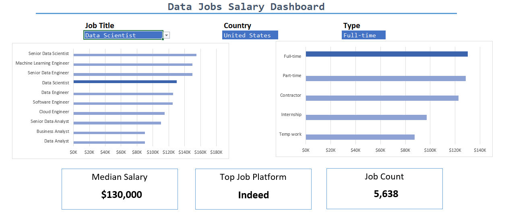

## Project Overview
This project features an interactive Microsoft Excel dashboard for exploring salary and job-market trends in data science and analytics. Users can filter the data by job title, country, and job schedule type to compare salary levels and explore differences across roles and regions. The dashboard turns raw job-posting data into an accessible tool for salary research and job-market analysis.

## Dashboard Preview

## Problem Statement
Salary information across job titles, countries, and employment types can be difficult to compare when it is spread across thousands of job postings. Job seekers and other users need a simple way to explore compensation patterns and understand how salaries vary by role, location, and schedule. This dashboard addresses that need through interactive filters, summary KPIs, and comparative charts.

## Dataset
- **Records:** Approximately 32,600 job postings
- **Period:** 2023
- **Domain:** Data science and analytics job market
- **Analysis dimensions:** Job title, country, job schedule type, salary, and hiring platform

## Tools & Excel Skills
- **Formulas and functions:** `MEDIAN`, `FILTER`, `UNIQUE`, `SORT`, `COUNT`, `COUNTIFS`, and `XLOOKUP`
- **Data validation:** Dropdowns for interactive filtering
- **Charts:** Horizontal bar charts for salary and job-schedule comparisons
- **Dashboard design:** KPI cards, layout, and interactive controls

## Dashboard Features
- **Interactive filters:** Explore results by job title, country, and job schedule type.
- **Salary comparison:** Compare salary levels across selected roles and locations.
- **Job-schedule analysis:** Review job-posting or salary comparisons by schedule type.
- **KPI cards:** Display median salary, job count, and top job platform.
- **Dynamic updates:** Use dropdown selections to tailor the dashboard view to a user's question.

## Analysis Performed
The dashboard supports comparisons of salary levels across job titles and countries, exploration of differences by job schedule type, and review of job-posting volume and hiring-platform representation. Formula-driven outputs and dropdown filters let users investigate the data without manually changing the underlying calculations.

## How to Use the Dashboard
1. Open the Excel workbook.
2. Select a job title, country, and job schedule type from the dropdown filters.
3. Review the updated KPI cards and charts.
4. Change the selections to compare different roles, locations, and work arrangements.

## Project Files
- [Interactive Excel dashboard and formulas](salary_dashboard.xlsx)
- [View the complete Salary Dashboard Report](report/salary_dashboard_report.pdf)

